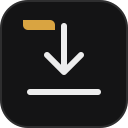
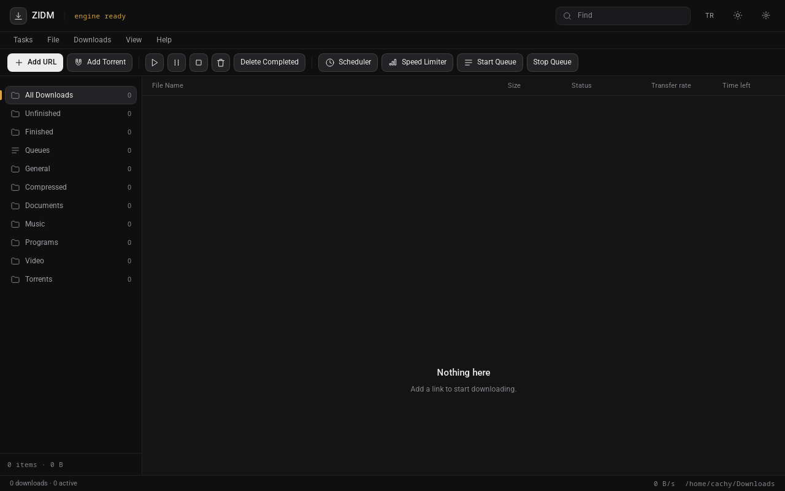

<div align="center">



# ZIDM

**A cross-platform download manager built with MyZig, aria2 and yt-dlp.**

[](https://github.com/agnogad/zidm/releases)
[](https://github.com/agnogad/zidm/actions/workflows/release.yml)
[](https://ziglang.org)
[](#build-from-source)
[](LICENSE)

</div>

---

ZIDM is a Zig reimplementation of the feature set of a classic desktop download
manager. The interface runs in the operating system's webview; Zig owns the
engine process, settings, IPC and file operations. `aria2` performs segmented
HTTP/FTP downloads and torrents, `yt-dlp` resolves video pages, and
`gallery-dl` handles galleries when installed.



## Features

**Downloads**
- **Add URL** (`Ctrl+N`) with address history, Save As, category, description,
  folder, HTTP basic auth and referer; **Download Now** or **Download Later**.
- Accepted schemes: `http`, `https`, `ftp`, `ftps`, `ftpes` and `magnet`.
- Segmented, resumable downloads through aria2 (1–128 connections per file).
- Pause, resume, stop, redownload, refresh address, move/rename, open file and
  open folder.
- Per-file and global speed limits; a download quota and a time-based queue
  scheduler.
- Duplicate handling, link grabber, numbered/letter **Batch download**,
  import/export of link lists, clipboard link capture.
- Column sorting, find (`Ctrl+F`, `F3`), multi-select, tri-state selection,
  categories (All / Unfinished / Finished / Queues + custom), right-click menus.
- Checksum verification: MD5, SHA-1, SHA-256, SHA-512 and CRC32.
- Delete with an optional "also delete the file" confirmation, and
  **Delete All Completed**.

**Torrents**
- Magnet links and `.torrent` files, file selection handled by aria2,
  seeding controlled by aria2 options.

**Video and galleries**
- **Download video from a page**: `yt-dlp` lookup, quality list, MP3/Opus/FLAC
  choices through yt-dlp, subtitles/chapters support in the command line.
- **Download a gallery** with `gallery-dl` when available.

**Interface**
- unslop design: graphite surfaces, one amber signal, film-strip detail,
  restrained motion, dark/light/follow-system themes.
- Interface size 90–200% (`Ctrl+`/`Ctrl-`/`Ctrl+0`), Turkish/English switch,
  keyboard shortcuts throughout, toasts and completion notifications.

## Downloads

Ready-built binaries are published on the
[releases page](https://github.com/agnogad/zidm/releases). The release workflow
builds each target on its own runner:

| Asset | Runner |
| --- | --- |
| `zidm-linux-x86_64` | Ubuntu 24.04 |
| `zidm-macos-x86_64` | macOS (Apple Silicon) |
| `zidm-windows-x86_64.exe` | Windows |

## Prerequisites

Install the helper programs and make sure they are on `PATH`:

```sh
# Linux
sudo apt-get install aria2 yt-dlp ffmpeg gallery-dl

# macOS
brew install aria2 yt-dlp ffmpeg gallery-dl

# Windows
winget install aria2.aria2 yt-dlp.yt-dlp Gyan.FFmpeg gallery-dl.gallery-dl
```

Only `aria2` is required for ordinary downloads; `yt-dlp` is needed for video
pages and `ffmpeg` for audio formats. ZIDM reports which helpers it found in
the top bar.

## Build from source

Requires [Zig 0.17.1](https://ziglang.org/download/). MyZig is a relative
package dependency, so clone the two repositories side by side:

```sh
git clone https://github.com/agnogad/myzig
git clone https://github.com/agnogad/zidm
cd zidm
zig build run
```

On Linux, install GTK 3, WebKitGTK 4.1, cairo and X11 development packages
first:

```sh
sudo apt-get install libgtk-3-dev libwebkit2gtk-4.1-dev libcairo2-dev libx11-dev
```

Cross-compile with the standard target flag:

```sh
zig build -Dtarget=x86_64-windows --prefix zig-out/windows
zig build -Dtarget=aarch64-macos  --prefix zig-out/macos
```

## Tests

```sh
zig build test          # pure-logic unit tests (URLs, categories, batch, checksum)
bash tests/full_test.sh # end-to-end feature check under Xvfb
```

The end-to-end test serves a small video over local HTTP and verifies engine
startup, add/list, pause/resume, completion, checksum, per-file and global
options, batch adds, video lookup, settings, keyboard shortcuts and dialogs.
It prints one `ZIDM FULLTEST PASS ...` line when every check succeeds.

## Project structure

```
build.zig, build.zig.zon   Zig build and the relative MyZig dependency
src/main.zig               IPC services, process helpers, event loop
src/engine.zig             aria2 JSON-RPC client over a raw TCP socket
src/logic.zig              pure helpers and unit tests
src/index.html             interface shell and SVG icon set
src/styles.css             unslop theme, layout, motion
src/app.js                 download list, dialogs, queues, scheduler
tests/full_test.sh         end-to-end feature check
docs/logo.svg              project logo
```

## Scope

This is a focused reimplementation of the download-management core. Features
that require browser extensions, native messaging, system keychains, a remote
phone server, 86 localized UI languages, custom rendering backends or debrid
account APIs are not included.

Design credits: unslop by Damir Sokolovsky
([@heydamir](https://x.com/heydamir)), CC BY 4.0. ZIDM itself is MIT licensed.
